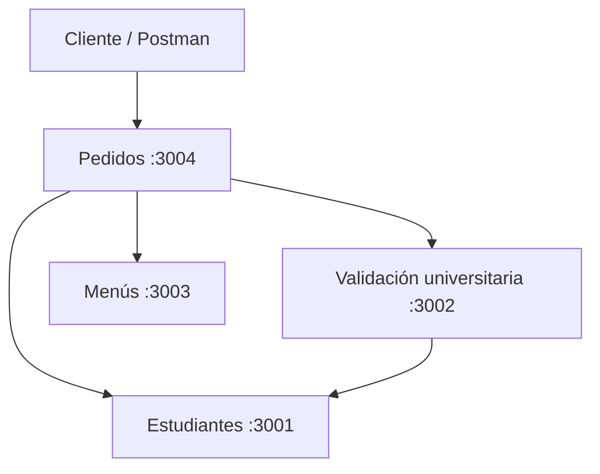

# Arquitectura inicial de UniFood

Cuatro API REST HTTP independientes en Node.js y Express. Cada una tendrá su base de datos SQLite aislada.

| Servicio | Puerto |
| --- | --- |
| estudiantes | 3001 |
| validacion-universitaria | 3002 |
| menus | 3003 |
| pedidos | 3004 |

Las direcciones internas de Docker son `http://estudiantes:3001`, `http://validacion-universitaria:3002` y `http://menus:3003`.

Por ahora cada servicio tiene solo `GET /health`. Las funcionalidades de negocio las desarrollarán sus responsables.
